# 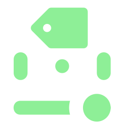 Godot Slider Label

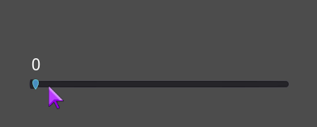

^ This can be your Slider, just install this plugin.

## Usage

After SliderLabel plugin is enabled, you can add a new SliderLabel node onto your scene. The node needs to be a child of Slider. Done. Your Slider will now display the value. You can customize the label formatting, like color, font (size) etc. and it will all display correctly. The label updates when slider's value changes. The label also automatically adjusts depending if used with HSlider or VSlider.

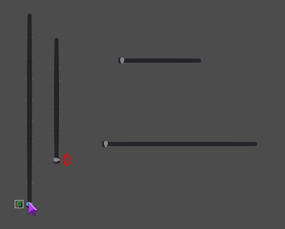

## Settings

SliderLabel comes with a few custom settings that can be used to customize its behavior. They also have documentation.

### Visibility Rule

Controls when the label will display. The options are:

- On Drag - label will display when the slider is being dragged.

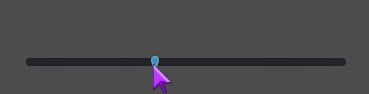

- On Hover - label will display when it's being hovered by cursor.

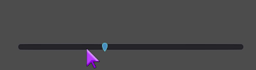

- On Hover (default) - the 2 above combined, i.e. slider is hovered or dragged.

- On Focus - label will display when it's currently focused. Works also with keyboard focus.

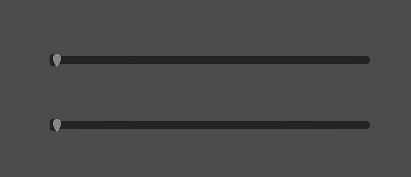

- Always - label will display.

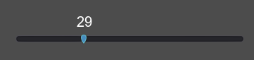

### Placement

Determines the side of the slider on which the label will be placed. Top/Bottom applies to HSlider and Right/Left to VSlider.

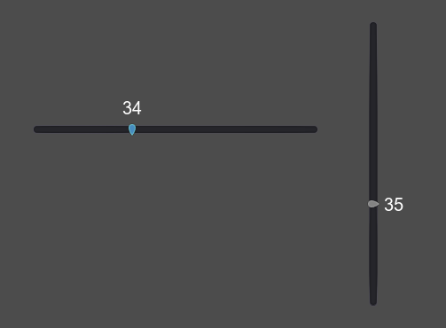
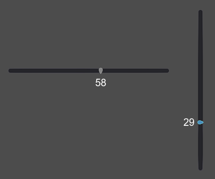

### Separation

The space in pixels between label's and slider's rects.

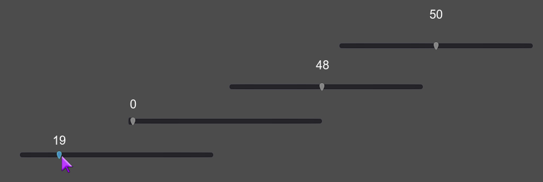

### Custom Format

Specifies the custom format for the value display. Requires exactly one placeholder (`%s`/`%d`/`%f`). You can also use it to display suffixes etc. Leave empty for no formatting.

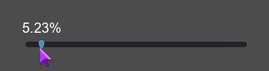

### Slider

Overrides the default behavior of using the parent. Useful when you want to put the label next to your slider, e.g. in a container.

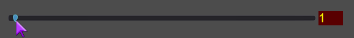

___
You can find all my addons on my [profile page](https://github.com/KoBeWi).

